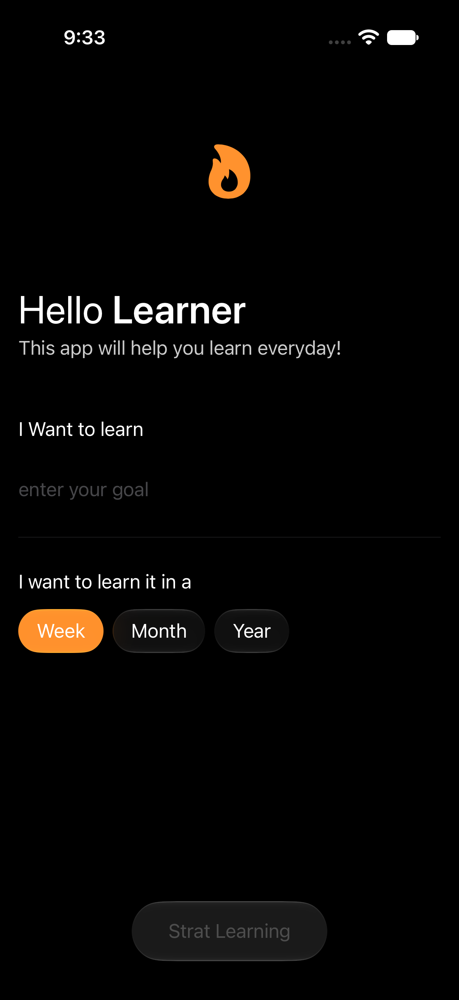
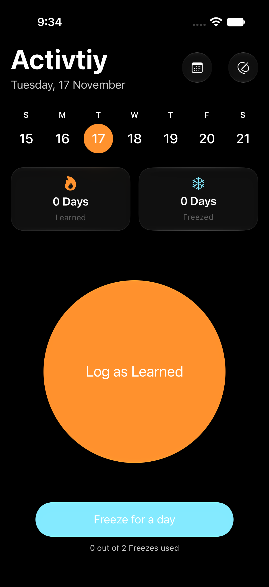
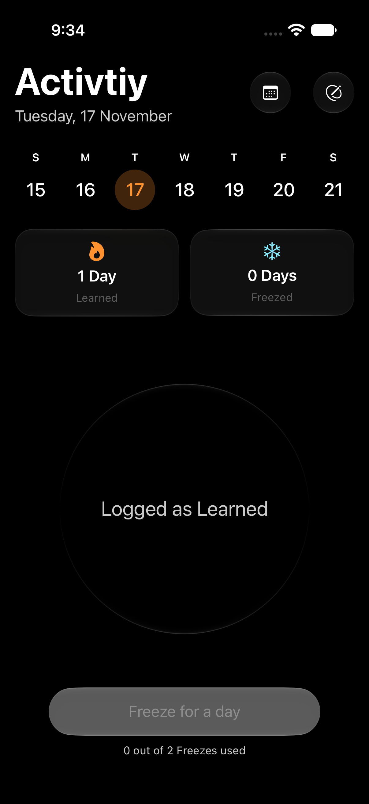
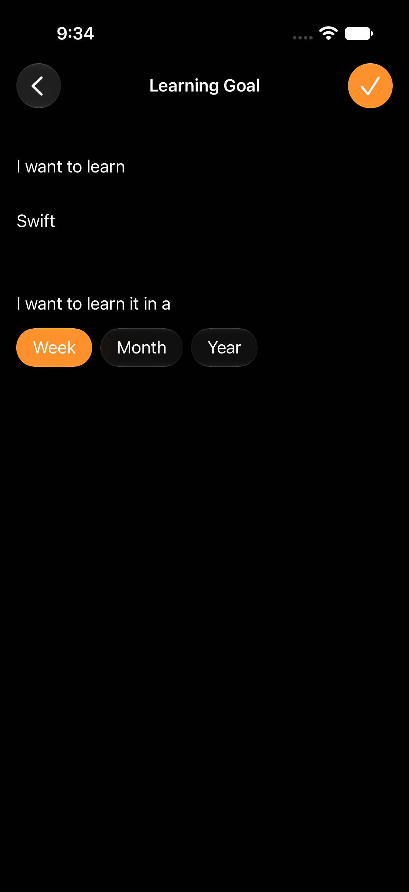
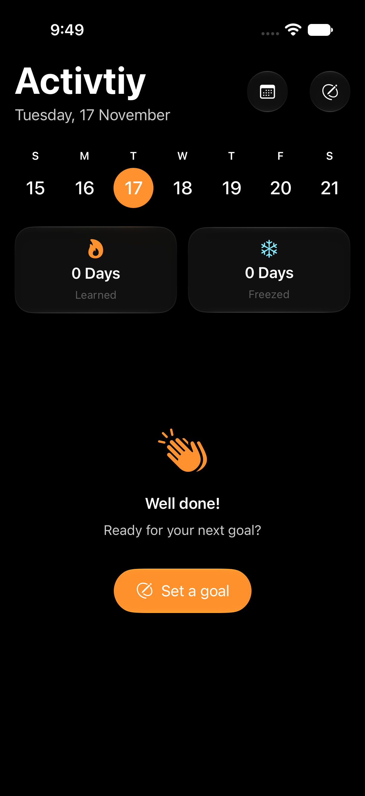
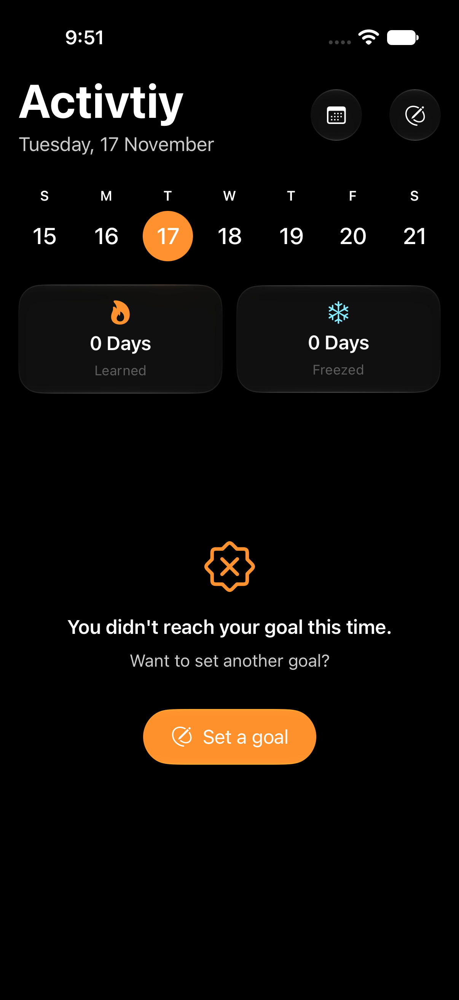
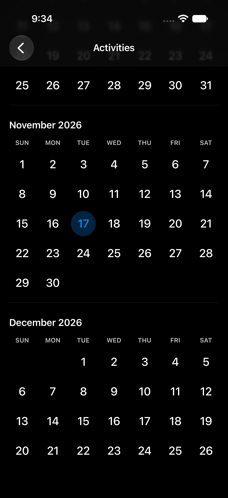

# Learning Journey

**Learning Journey** is an iOS app that helps you build a daily learning habit. You set a topic and a time frame (a week, a month or a year), then log every day you learn, and the app tracks your streak.

---

##  Main Features

- **Set a learning goal:** choose what you want to learn and pick a duration: Week, Month or Year.
- **Log a day as learned:** one tap on the big button. Tap again to undo it the same day.
- **Freeze a day:** keep your streak on days you can't learn. Freezes are limited by duration:
  - Week: 2 freezes
  - Month: 8 freezes
  - Year: 96 freezes
- **Weekly view:** see the current week at a glance. Learned days are orange, freezed days are blue, and today is highlighted.
- **Progress counters:** days learned and days freezed, with correct wording ("1 Day" / "2 Days").
- **Streak rules:**
  - The streak resets after **32 hours** without logging or freezing.
  - Buttons are disabled once today is logged, and become active again at **12 AM**.
- **Goal completed / goal not met:** the app tells you when you finish your goal or miss it, and lets you set a new or the same goal.
- **Edit your goal:** change the topic or duration. A confirmation alert warns that updating will restart the streak. The ✓ button is only enabled when something changed.
- **Calendar:** a view-only calendar of the whole year, opening on the current month, showing every learned and freezed day from all your goals.
- **Saves your progress:** your goal and logged days are kept after closing the app.

---

##  Screenshots

<table>
  <tr>
    <th>Onboarding</th>
    <th>Activity</th>
    <th>Logged Today</th>
    <th>Edit Goal</th>
  </tr>
  <tr>
    <td></td>
    <td></td>
    <td></td>
    <td></td>
  </tr>
  <tr>
    <th>Goal Completed</th>
    <th>Goal Not Met</th>
    <th>Calendar</th>
    <th></th>
  </tr>
  <tr>
    <td></td>
    <td></td>
    <td></td>
    <td></td>
  </tr>
</table>

---

##  Technologies Used

| Technology | Used for |
|------------|----------|
| **Swift** | The app's language |
| **SwiftUI** | All screens and layouts |
| **MVVM** | Separating data (Models), logic (ViewModels) and UI (Views) |
| **Observation (`@Observable`)** | Updating the screens automatically when data changes |
| **Liquid Glass (iOS 26)** | Glass buttons, cards and pills (`glassEffect`, `glassProminent`) |
| **Codable + UserDefaults** | Saving and loading the goal and logged days |
| **NavigationStack** | Moving between Activity, Edit Goal and Calendar |
| **Xcode 26** | Development |
| **Git & GitHub** | Version control with feature branches and pull requests |

---

##  Project Structure (MVVM)

```
LearningJourney/
├── Models/
│   ├── LearningGoal.swift        # topic + duration + start date
│   ├── GoalDuration.swift        # week / month / year, freeze limits, total days
│   ├── DayLog.swift              # one logged day: date + status
│   ├── DayStatus.swift           # learned / freezed
│   └── GoalProgress.swift        # in progress / completed / not met
├── ViewModel/
│   ├── LearningViewModel.swift   # shared app data, rules, saving
│   ├── OnboardingViewModel.swift # goal form state
│   └── CalendarViewModel.swift   # month and day calculations
├── View/
│   ├── OnBoarding.swift
│   ├── ActivityScreen.swift
│   ├── EditGoalScreen.swift
│   ├── CalendarScreen.swift
│   ├── GoalForm.swift            # topic field + duration pills
│   ├── GoalEndedView.swift       # "Well done!" / "You didn't reach your goal"
│   ├── DayCircle.swift           # reusable day circle (week strip + calendar)
│   └── StatCard.swift            # reusable counter card
└── LearningJourneyApp.swift      # shows Onboarding or Activity
```

---

##  Design Decisions

- A **Month** goal counts as **30 days** and a **Year** goal as **365 days**.
- A goal is completed when the number of learned **or** freezed days reaches the goal's length.
- Updating a goal gives it a new start date, so the streak restarts, but **past days stay visible in the Calendar**.
- Undoing "Log as Learned" is an addition beyond the original design.

---

##  How to Run

1. Clone the repository.
2. Open `LearningJourney.xcodeproj` in **Xcode 26** or later.
3. Run on an iOS 26 simulator or device.
